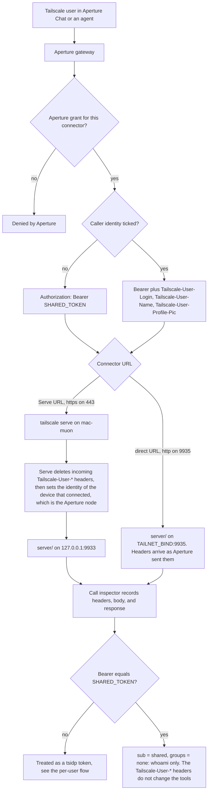
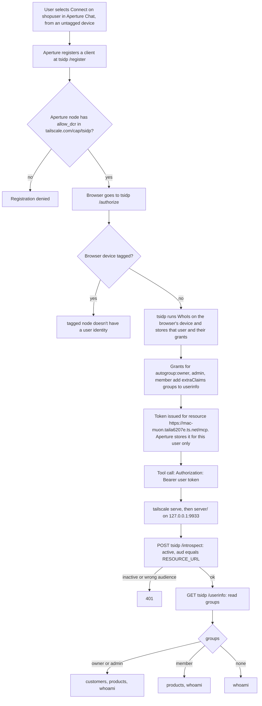

# tsidp-mcp

A small remote MCP server for a mock coffee-wholesale catalog. Postgres runs in Docker. The MCP endpoint is streamable HTTP. It compares two ways of telling an MCP server who the Tailscale user is:

1. **Shared credential.** One static bearer for everyone, sent by Aperture. With the connector's **Caller identity** box ticked, Aperture also forwards the caller's login, name, and picture as headers.
2. **Per-user token from [tsidp](https://github.com/tailscale/tsidp).** Tailscale's OIDC identity provider issues each user their own token, and the tailnet policy stamps a `groups` claim on it.

Only the second one gives the MCP server a group it can use to choose tools. See [Can caller identity choose the tools?](#can-caller-identity-choose-the-tools)

Tailnet: `taila6207e.ts.net`. This Mac is `mac-muon`.

| Connector | URL | Credential | Tools |
| --- | --- | --- | --- |
| `shopshared` | `https://mac-muon.taila6207e.ts.net/mcp` (Serve), or `http://mac-muon.taila6207e.ts.net:9935/mcp` (direct) to see Caller identity headers | `SHARED_TOKEN` | `whoami` |
| `shopuser` | `https://mac-muon.taila6207e.ts.net/mcp` (Serve) | per-user tsidp token | by `groups` claim, see [Tool tiers](#tool-tiers) |

Every call to `/mcp` shows up in the [call inspector](#call-inspector) at `http://127.0.0.1:9934/` (or `https://mac-muon.taila6207e.ts.net:8443/` on the tailnet), with its headers.

## How the shared credential works



The bearer proves the request came through Aperture (or from anyone else holding the bearer). It does not say who the user is. The headers say who the user is, but the MCP server cannot verify them: anyone who can reach port 9935 with the bearer can send any login.

## How the per-user tsidp token works



The group comes from the tailnet policy and travels inside a token that the MCP server checks with tsidp. No logins or groups are listed in the server.

## Tool tiers

From `server/src/access.js`.

| `groups` value | Tools |
| --- | --- |
| `owner` or `admin` (or the `autogroup:` forms) | `list_customers`, `get_customer`, `search_customers`, `list_products`, `search_products`, `whoami` |
| `member` | `list_products`, `search_products`, `whoami` |
| none, or the shared bearer | `whoami` |

When both `owner`/`admin` and `member` are present, `owner` or `admin` wins. `list_orders` and `get_order` exist in `server/src/tools.js` but no tier grants them.

## Can caller identity choose the tools?

Not by itself. Ticking **Caller identity** (`send_caller_identity`) makes Aperture forward three headers, and none of them is a group:

| Header | Example |
| --- | --- |
| `Tailscale-User-Login` | `vinay.valson@gmail.com` |
| `Tailscale-User-Name` | `Vinay Valson` |
| `Tailscale-User-Profile-Pic` | profile image URL |

A live request from `aperture-1` (`100.109.60.70`) to this Mac carried exactly these. They are the same three that [Tailscale Serve](https://tailscale.com/docs/features/tailscale-serve#identity-headers) sets. To pick tools by group from a login, the MCP server would need one of these:

- **A login-to-group table in the server.** This is hardcoding, and it drifts from the tailnet policy.
- **A Tailscale API lookup per caller.** This needs an OAuth client with `users:read` for the role (owner, admin, member) and `policy_file:read` for `group:` members, stored on the MCP host. That is an admin-scoped secret in the MCP server, plus a network call on every new caller.

Either way the login is still unsigned, so whoever holds the bearer can claim any login.

Aperture can filter by group, but at the gateway rather than in the MCP server. Add the [`tailscale.com/visible-groups`](https://tailscale.com/docs/aperture/visible-groups) node attribute for the Aperture node, then use [`connectors` grants](https://tailscale.com/docs/aperture/how-to/grant-mcp-tool-access) such as `"shopshared/tools/list_products"` with a `group:` `src`. The upstream still sees one credential and has to return every tool, so that only works if the bearer gets the full set and every client goes through Aperture. Cursor pointed straight at the server would get the full set.

With tsidp, the group is a claim on a per-user token that the server introspects. It works for any MCP client, including Cursor without Aperture, and the server holds no Tailscale admin credential.

## Start the database

```bash
cd ~/Projects/tsidp-mcp
docker compose up -d db
```

Postgres listens on `127.0.0.1:54329`. The MCP role `mcp_reader` can only `SELECT`. Seed data is customers, products, orders, and order items (Northwind Cafe, Harbor & Rye, and so on).

## Start tsidp

tsidp is a separate tailnet node, which is the setup in the current [tsidp README](https://github.com/tailscale/tsidp). No auth key is stored here. On first start the container prints a Tailscale login URL.

```bash
docker compose up -d tsidp
docker compose logs -f tsidp
```

Open the `https://login.tailscale.com/a/...` URL and approve the node. Its name is `idp`, so the issuer is:

`https://idp.taila6207e.ts.net`

HTTPS for that name can take a minute after approval. Check:

```bash
curl -4sS https://idp.taila6207e.ts.net/.well-known/openid-configuration
```

## Tailnet policy

Edit the policy at <https://login.tailscale.com/admin/acls>. Add the grants below to the existing `grants` array. Nothing else in the policy changes.

The MCP resource URL is `https://mac-muon.taila6207e.ts.net/mcp`. `resources` has to match that string exactly. tsidp checks it when a token is issued for this server.

### Dynamic client registration

tsidp denies `/register` unless the caller has `tailscale.com/cap/tsidp` with `allow_dcr` true. Aperture's `shopuser` connector registers from the Aperture node, which is logged in as `vinay.valson@gmail.com`. This Mac is tagged, so a register call from here is a different identity.

`users` is which logins may be the subject of a token for those resources. `["*"]` allows any tailnet user.

### Group claim

tsidp does not copy Tailscale groups onto a token by itself. The last three grants stamp a `groups` claim from the caller's autogroup, and only when `includeInUserInfo` is true. The MCP server reads `groups` from `https://idp.taila6207e.ts.net/userinfo`.

`autogroup:admin` is the Admin role only. The Owner role is `autogroup:owner`, so the owner grant is what gives that account the broader tool set. `autogroup:member` includes every direct member, including owners and admins.

The claim is taken from the WhoIs snapshot stored when the user finishes Connect. After changing these grants, each person connects `shopuser` again and refreshes tools. `whoami` shows the `groups` array on that token.

### All four grants

```hujson
"grants": [
  {
    "src": ["vinay.valson@gmail.com"],
    "dst": ["*"],
    "app": {
      "tailscale.com/cap/tsidp": [
        {
          "allow_dcr": true,
          "users": ["*"],
          "resources": ["https://mac-muon.taila6207e.ts.net/mcp"]
        }
      ]
    }
  },
  {
    "src": ["autogroup:owner"],
    "dst": ["*"],
    "app": {
      "tailscale.com/cap/tsidp": [{
        "includeInUserInfo": true,
        "extraClaims": { "groups": ["owner"] }
      }]
    }
  },
  {
    "src": ["autogroup:admin"],
    "dst": ["*"],
    "app": {
      "tailscale.com/cap/tsidp": [{
        "includeInUserInfo": true,
        "extraClaims": { "groups": ["admin"] }
      }]
    }
  },
  {
    "src": ["autogroup:member"],
    "dst": ["*"],
    "app": {
      "tailscale.com/cap/tsidp": [{
        "includeInUserInfo": true,
        "extraClaims": { "groups": ["member"] }
      }]
    }
  }
]
```

Aperture connector grants (`shopshared/**`, `shopuser/**`) are set in the Aperture configuration, not in this tailnet policy.

## Start the MCP server

```bash
cd ~/Projects/tsidp-mcp/server
npm install
npm start
```

`npm run verify` checks the seed data, the tool list, and the tool tiers against the running database.

The server always listens on `127.0.0.1:9933`, which `tailscale serve --bg 9933` publishes. With `TAILNET_BIND` set in `.env` (this Mac's `tailscale ip -4`, `100.78.230.18`), it also listens on `TAILNET_BIND:9935`. Nothing rewrites headers on that port. Do not publish 9935 with `tailscale serve`, or Serve will rewrite them.

## Call inspector

Open `http://127.0.0.1:9934/` on this Mac. The page updates live. To open it from another tailnet device, publish it over HTTPS:

```bash
tailscale serve --bg --https=8443 http://127.0.0.1:9934
```

Then use `https://mac-muon.taila6207e.ts.net:8443/`. Anyone the tailnet policy lets reach `mac-muon` can see the recorded calls, including logins and bodies. Bearer tokens stay redacted. `tailscale serve --https=8443 off` removes it.

Browsers cannot open `http://mac-muon.taila6207e.ts.net:9935/` (or any plain `http://` `*.ts.net` URL). `ts.net` is on the HSTS preload list, so the browser switches to HTTPS, and port 9935 only speaks HTTP. Aperture and curl are not browsers and use the 9935 URL fine.

The strip at the top lists everyone who has called, with their groups, how many tools they get, and how many requests and tool calls they made. Click a person to show only their calls.

Each request to `/mcp` is one row, including ones that fail auth. The columns:

- **User (verified):** the person the server authenticated. For a tsidp token this is the email tsidp vouched for. The shared bearer shows "shared bearer, no user", because it does not identify a person
- **Groups:** the `groups` claim the server used to pick tools
- **Call** and **Status:** the JSON-RPC method and tool name, and the HTTP status
- **Via:** `Serve` (port 9933) or `direct` (port 9935)
- **Header login (not verified):** the `Tailscale-User-Login` header and where it came from. When it names someone other than the verified user, the row says so

Selecting a row shows the verified user, their groups, and their tools first, then the identity headers, every request header (`Authorization` and `Cookie` show only the scheme and the length), the body, and the response.

Through Serve, the header login on a `shopuser` call is the Aperture node's owner, not the person. For example, Vinnie's calls show `vinay.valson@gmail.com` in the header column, with a note that it differs from the verified user.

The badge in the header column says where the `Tailscale-User-*` headers came from:

| Badge | Meaning |
| --- | --- |
| sent by caller | The headers arrived exactly as the client sent them. Through Aperture on port 9935, this is the Caller identity option. |
| set by Tailscale Serve | Serve deleted anything the client sent and wrote the identity of the device that connected. Serve also adds `Tailscale-Headers-Info` when it does this. |
| none | No identity headers. |

The last 200 calls are kept in memory. Restarting the server clears them, as does Clear.

### Compare Caller identity on and off

1. Set `TAILNET_BIND=100.78.230.18` in `.env` and restart. The log prints `Listening on http://100.78.230.18:9935/mcp`.
2. In Aperture, set the `shopshared` URL to the direct listener. `send_caller_identity` only accepts a MagicDNS name or a Tailscale IP, and this URL is a MagicDNS name.

   ```json
   {
     "shopshared": {
       "protocol": "mcp",
       "url": "http://mac-muon.taila6207e.ts.net:9935/mcp",
       "auth": { "type": "bearer_token", "secret": "<SHARED_TOKEN>" },
       "send_caller_identity": true,
       "provider": "Custom"
     }
   }
   ```

3. Call `shopshared` `whoami` from Aperture Chat with **Caller identity** unticked, then ticked. Unticked calls show `none`. Ticked calls show `sent by caller` with your login, name, and picture. The tools stay `whoami` either way.
4. To compare with Serve, point `shopshared` back at `https://mac-muon.taila6207e.ts.net/mcp`. The checkbox stops mattering. If the Aperture node is logged in as a user, every call shows `set by Tailscale Serve` with that user's login, whoever is chatting. If the node is tagged, calls show `none`.

## Aperture connectors

The gateway is `https://aperture.taila6207e.ts.net`. It can reach the shop server at `https://mac-muon.taila6207e.ts.net/mcp` after `tailscale serve --bg 9933`. In Aperture, open Administration, then Connectors (or Configuration at `/admin/settings/config`). Connector IDs are letters and digits only.

`shopshared` uses one bearer for every granted user. The secret is `SHARED_TOKEN` in `.env`. That caller shows up as `sub` `shared` with no groups, so it only gets `whoami`. Caller identity headers only reach the server on the direct listener; see [Compare Caller identity on and off](#compare-caller-identity-on-and-off).

`shopuser` is per-user. Aperture registers a client with tsidp (`oauth2_dcr`) and stores a separate token for each Tailscale user. Each person opens Connectors in Aperture Chat and selects Connect. Do that from an untagged device (the iPhone or another machine logged in as you). This Mac is tagged, and tsidp rejects that login.

## Stop

```bash
# Ctrl-C the npm process, then:
docker compose stop
```

`docker compose down -v` also deletes the database volume and the tsidp node state.
