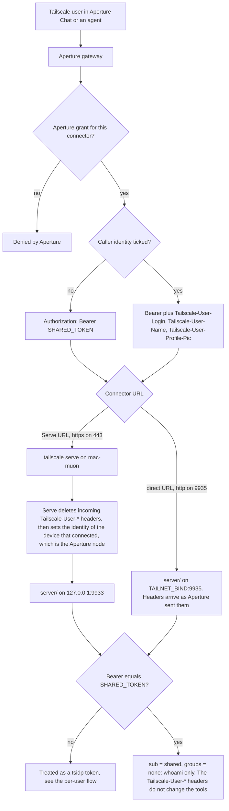
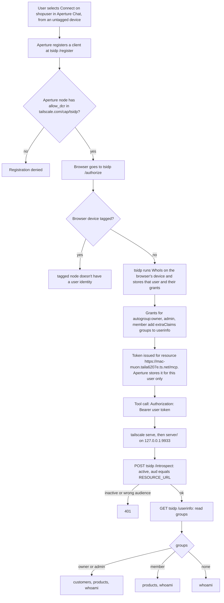

# tsidp-mcp

A small remote MCP server for a mock coffee-wholesale catalog. Postgres runs in Docker. The MCP endpoint is streamable HTTP. It compares two ways of telling an MCP server who the Tailscale user is:

1. **Shared credential.** One static bearer for everyone, sent by Aperture. With the connector's **Caller identity** box ticked, Aperture also forwards the caller's login, name, and picture as headers.
2. **Per-user token from [tsidp](https://github.com/tailscale/tsidp).** Tailscale's OIDC identity provider issues each user their own token, and the tailnet policy stamps a `groups` claim on it.

Only the second one gives the MCP server a group it can use to choose tools. See [Can caller identity choose the tools?](#can-caller-identity-choose-the-tools)

Tailnet: `taila6207e.ts.net`. This Mac is `mac-muon`.

| Connector | URL | Credential | Tools |
| --- | --- | --- | --- |
| `shopshared` | `https://mac-muon.taila6207e.ts.net/mcp` (Serve), or `http://mac-muon.taila6207e.ts.net:9935/mcp` (direct) to see Caller identity headers | `SHARED_TOKEN` | `whoami` |
| `shopuser` | `https://mac-muon.taila6207e.ts.net/mcp` (Serve) | per-user tsidp token | by `groups` claim, see [Tool tiers](#tool-tiers) |

The names in the rest of this document are this tailnet. To run the same stack on yours, follow [Run on your tailnet](#run-on-your-tailnet).

## How the shared credential works



The bearer proves the request came through Aperture (or from anyone else holding the bearer). It does not say who the user is. The headers say who the user is, but the MCP server cannot verify them: anyone who can reach port 9935 with the bearer can send any login.

## How the per-user tsidp token works



The group comes from the tailnet policy and travels inside a token that the MCP server checks with tsidp. No logins or groups are listed in the server.

## Tool tiers

From `server/src/access.js`.

| `groups` value | Tools |
| --- | --- |
| `owner` or `admin` (or the `autogroup:` forms) | `list_customers`, `get_customer`, `search_customers`, `list_products`, `search_products`, `whoami` |
| `member` | `list_products`, `search_products`, `whoami` |
| none, or the shared bearer | `whoami` |

When both `owner`/`admin` and `member` are present, `owner` or `admin` wins. `list_orders` and `get_order` exist in `server/src/tools.js` but no tier grants them.

## Can caller identity choose the tools?

Not by itself. Ticking **Caller identity** (`send_caller_identity`) makes Aperture forward three headers, and none of them is a group:

| Header | Example |
| --- | --- |
| `Tailscale-User-Login` | `vinay.valson@gmail.com` |
| `Tailscale-User-Name` | `Vinay Valson` |
| `Tailscale-User-Profile-Pic` | profile image URL |

A live request from `aperture-1` (`100.109.60.70`) to this Mac carried exactly these. They are the same three that [Tailscale Serve](https://tailscale.com/docs/features/tailscale-serve#identity-headers) sets. To pick tools by group from a login, the MCP server would need one of these:

- **A login-to-group table in the server.** This is hardcoding, and it drifts from the tailnet policy.
- **A Tailscale API lookup per caller.** This needs an OAuth client with `users:read` for the role (owner, admin, member) and `policy_file:read` for `group:` members, stored on the MCP host. That is an admin-scoped secret in the MCP server, plus a network call on every new caller.

Either way the login is still unsigned, so whoever holds the bearer can claim any login.

Aperture can filter by group, but at the gateway rather than in the MCP server. Add the [`tailscale.com/visible-groups`](https://tailscale.com/docs/aperture/visible-groups) node attribute for the Aperture node, then use [`connectors` grants](https://tailscale.com/docs/aperture/how-to/grant-mcp-tool-access) such as `"shopshared/tools/list_products"` with a `group:` `src`. The upstream still sees one credential and has to return every tool, so that only works if the bearer gets the full set and every client goes through Aperture. Cursor pointed straight at the server would get the full set.

With tsidp, the group is a claim on a per-user token that the server introspects. It works for any MCP client, including Cursor without Aperture, and the server holds no Tailscale admin credential.

## Run on your tailnet

`docker compose up -d` starts four services:

| Service | Where it lives | What it is |
| --- | --- | --- |
| `tsidp` | its own tailnet node, `idp.<tailnet>.ts.net` | Tailscale's OIDC provider |
| `ts-shop` | its own tailnet node, `shop-mcp.<tailnet>.ts.net` | Tailscale, in userspace mode. No `/dev/net/tun`, so it runs on Docker Desktop |
| `shop` | shares `ts-shop`'s network | the MCP server |
| `db` | the Compose network only | Postgres. Other containers reach it as `db:5432`. It has no tailnet address. The host can reach it at `127.0.0.1:54329` |

The sidecar publishes two ports on the shop node:

| Port | Mode | URL |
| --- | --- | --- |
| 443 | HTTPS Serve. Rewrites `Tailscale-User-*` headers | `https://shop-mcp.<tailnet>.ts.net/mcp` |
| 9935 | raw TCP forward to the server. Headers arrive unchanged | `http://shop-mcp.<tailnet>.ts.net:9935/mcp` |
| 8443 | HTTPS Serve, the call inspector | `https://shop-mcp.<tailnet>.ts.net:8443/` |

The server reaches tsidp through the sidecar's HTTP proxy, because userspace mode has no tunnel interface. Postgres is excluded from that proxy.

### Before the first start

1. Docker, and a tailnet with MagicDNS and HTTPS certificates turned on at <https://login.tailscale.com/admin/dns>.
2. An Aperture gateway on that tailnet, if you want the two connectors.
3. Copy the env file and fill it in. Passwords must not contain `@`, `:`, `/`, or a space.

   ```bash
   cp example.env .env
   ```

   `TSIDP_URL` is `https://idp.<tailnet>.ts.net`. `SHOP_RESOURCE_URL` is `https://shop-mcp.<tailnet>.ts.net/mcp`. Generate `SHARED_TOKEN` with `openssl rand -hex 24`.

   `TS_AUTHKEY` is optional. An auth key from <https://login.tailscale.com/admin/settings/keys> lets `ts-shop` join on its own. Leave it empty to approve a login URL instead. Do not commit a real key.

### Start

```bash
docker compose up -d --build
docker compose logs -f tsidp ts-shop
```

Each of those two containers prints a `https://login.tailscale.com/a/...` URL the first time, unless `TS_AUTHKEY` is set. Approve both. `tsidp` becomes `idp`, and `ts-shop` becomes `shop-mcp`. HTTPS for the new names can take a minute.

```bash
curl -4sS https://idp.<tailnet>.ts.net/.well-known/openid-configuration
curl -4sS -o /dev/null -w "%{http_code}\n" https://shop-mcp.<tailnet>.ts.net/mcp
```

The second command returns `401`. That is the MCP server answering.

The database init scripts run only when the data volume is first created. `docker compose down -v` deletes that volume, the tsidp node state, and the shop node state.

### Tailnet policy

In the [grants below](#all-four-grants), change two things:

- `resources` becomes your `SHOP_RESOURCE_URL`, character for character. tsidp checks it when it issues a token.
- The `allow_dcr` grant's `src` becomes the login of the Aperture node on your tailnet. tsidp denies `/register` to anyone else.

The `autogroup` grants need no names from your tailnet. They stamp `groups` onto whoever connects.

Aperture also needs its own grants for `shopshared/**` and `shopuser/**`. Those live in the Aperture configuration, not in the tailnet policy.

Connect `shopuser` from an untagged device. tsidp rejects `/authorize` from a tagged node with `tagged node doesn't have a user identity`.

### Aperture

| Connector | URL | Caller identity |
| --- | --- | --- |
| `shopuser` | `https://shop-mcp.<tailnet>.ts.net/mcp` | leave unticked. The per-user token carries the identity |
| `shopshared` | `http://shop-mcp.<tailnet>.ts.net:9935/mcp` | ticked, when you want the caller's login in the headers |

`shopshared` on port 443 shows the Aperture node's owner in the headers, whichever person is chatting. Port 9935 shows the person. Neither header changes the tools: the shared bearer gets `whoami` only.

## Start the database

```bash
cd ~/Projects/tsidp-mcp
docker compose up -d db
```

Postgres listens on `127.0.0.1:54329`. The MCP role `mcp_reader` can only `SELECT`. Seed data is customers, products, orders, and order items (Northwind Cafe, Harbor & Rye, and so on).

## Start tsidp

tsidp is a separate tailnet node, which is the setup in the current [tsidp README](https://github.com/tailscale/tsidp). No auth key is stored here. On first start the container prints a Tailscale login URL.

```bash
docker compose up -d tsidp
docker compose logs -f tsidp
```

Open the `https://login.tailscale.com/a/...` URL and approve the node. Its name is `idp`, so the issuer is:

`https://idp.taila6207e.ts.net`

HTTPS for that name can take a minute after approval. Check:

```bash
curl -4sS https://idp.taila6207e.ts.net/.well-known/openid-configuration
```

## Tailnet policy

Edit the policy at <https://login.tailscale.com/admin/acls>. Add the grants below to the existing `grants` array. Nothing else in the policy changes.

The MCP resource URL is `https://mac-muon.taila6207e.ts.net/mcp`. `resources` has to match that string exactly. tsidp checks it when a token is issued for this server.

### Dynamic client registration

tsidp denies `/register` unless the caller has `tailscale.com/cap/tsidp` with `allow_dcr` true. Aperture's `shopuser` connector registers from the Aperture node, which is logged in as `vinay.valson@gmail.com`. This Mac is tagged, so a register call from here is a different identity.

`users` is which logins may be the subject of a token for those resources. `["*"]` allows any tailnet user.

### Group claim

tsidp does not copy Tailscale groups onto a token by itself. The last three grants stamp a `groups` claim from the caller's autogroup, and only when `includeInUserInfo` is true. The MCP server reads `groups` from `https://idp.taila6207e.ts.net/userinfo`.

`autogroup:admin` is the Admin role only. The Owner role is `autogroup:owner`, so the owner grant is what gives that account the broader tool set. `autogroup:member` includes every direct member, including owners and admins.

The claim is taken from the WhoIs snapshot stored when the user finishes Connect. After changing these grants, each person connects `shopuser` again and refreshes tools. `whoami` shows the `groups` array on that token.

### All four grants

```hujson
"grants": [
  {
    "src": ["vinay.valson@gmail.com"],
    "dst": ["*"],
    "app": {
      "tailscale.com/cap/tsidp": [
        {
          "allow_dcr": true,
          "users": ["*"],
          "resources": ["https://mac-muon.taila6207e.ts.net/mcp"]
        }
      ]
    }
  },
  {
    "src": ["autogroup:owner"],
    "dst": ["*"],
    "app": {
      "tailscale.com/cap/tsidp": [{
        "includeInUserInfo": true,
        "extraClaims": { "groups": ["owner"] }
      }]
    }
  },
  {
    "src": ["autogroup:admin"],
    "dst": ["*"],
    "app": {
      "tailscale.com/cap/tsidp": [{
        "includeInUserInfo": true,
        "extraClaims": { "groups": ["admin"] }
      }]
    }
  },
  {
    "src": ["autogroup:member"],
    "dst": ["*"],
    "app": {
      "tailscale.com/cap/tsidp": [{
        "includeInUserInfo": true,
        "extraClaims": { "groups": ["member"] }
      }]
    }
  }
]
```

Aperture connector grants (`shopshared/**`, `shopuser/**`) are set in the Aperture configuration, not in this tailnet policy.

## Start the MCP server

The Compose file starts it. See [Run on your tailnet](#run-on-your-tailnet).

```bash
docker compose up -d --build shop
```

To run it on the host instead, for development:

```bash
cd ~/Projects/tsidp-mcp/server
npm install
npm start
```

`npm run verify` checks the seed data, the tool list, and the tool tiers against the database at `127.0.0.1:54329`. The host process listens on `127.0.0.1:9933`. With `TAILNET_BIND` set to this machine's `tailscale ip -4`, it also listens on that address at `TAILNET_PORT`, and nothing rewrites headers there. Do not publish that port with `tailscale serve`, or Serve will rewrite them. The container does not need `TAILNET_BIND`: its sidecar forwards tailnet port 9935 to `127.0.0.1:9935` as raw TCP.

Browsers cannot open `http://mac-muon.taila6207e.ts.net:9935/` (or any plain `http://` `*.ts.net` URL). `ts.net` is on the HSTS preload list, so the browser switches to HTTPS, and port 9935 only speaks HTTP. Aperture and curl are not browsers and use the 9935 URL fine.

### Compare Caller identity on and off

On the Compose service the direct URL is already `http://<shop-hostname>.<tailnet>.ts.net:9935/mcp`. The steps below are the host-run server on this machine.

1. Set `TAILNET_BIND` to this machine's Tailscale address in `.env` and restart. The log prints `Listening on http://<tailscale-ip>:9935/mcp`.
2. In Aperture, set the `shopshared` URL to the direct listener. `send_caller_identity` only accepts a MagicDNS name or a Tailscale IP, and this URL is a MagicDNS name.

   ```json
   {
     "shopshared": {
       "protocol": "mcp",
       "url": "http://mac-muon.taila6207e.ts.net:9935/mcp",
       "auth": { "type": "bearer_token", "secret": "<SHARED_TOKEN>" },
       "send_caller_identity": true,
       "provider": "Custom"
     }
   }
   ```

3. Call `shopshared` `whoami` from Aperture Chat with **Caller identity** unticked, then ticked. Unticked, the request has no `Tailscale-User-*` headers. Ticked, it carries that person's login, name, and picture. The tools stay `whoami` either way.
4. To compare with Serve, point `shopshared` back at `https://mac-muon.taila6207e.ts.net/mcp`. The checkbox stops mattering. Serve writes the login of whoever owns the Aperture node, for every person. A tagged Aperture node gets no identity headers.

## Aperture connectors

The gateway is `https://aperture.taila6207e.ts.net`. It can reach the shop server at `https://mac-muon.taila6207e.ts.net/mcp` after `tailscale serve --bg 9933`. In Aperture, open Administration, then Connectors (or Configuration at `/admin/settings/config`). Connector IDs are letters and digits only.

`shopshared` uses one bearer for every granted user. The secret is `SHARED_TOKEN` in `.env`. That caller shows up as `sub` `shared` with no groups, so it only gets `whoami`. Caller identity headers only reach the server on the direct listener; see [Compare Caller identity on and off](#compare-caller-identity-on-and-off).

`shopuser` is per-user. Aperture registers a client with tsidp (`oauth2_dcr`) and stores a separate token for each Tailscale user. Each person opens Connectors in Aperture Chat and selects Connect. Do that from an untagged device (the iPhone or another machine logged in as you). This Mac is tagged, and tsidp rejects that login.

## Stop

```bash
docker compose stop
```

`docker compose down -v` also deletes the database volume, the tsidp node state, and the shop node state. A host `npm start` stops with Ctrl-C.
